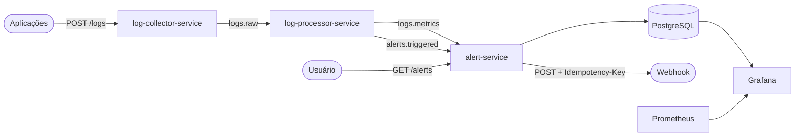

# 📡 Realtime Log Monitor

Pipeline de monitoramento de logs em tempo real construído com Java, Spring Boot, Apache Kafka e Kafka Streams.

Aplicações enviam lotes de logs para um coletor HTTP. Os logs passam pelo Kafka e são deduplicados e contados por
serviço em janelas de um minuto. Quando um serviço registra mais de 50 erros no mesmo minuto, o sistema abre um
incidente, guarda o histórico no PostgreSQL e notifica um webhook. O Grafana mostra tanto os incidentes quanto a saúde
do próprio pipeline.

## 🛠️ Tecnologias

- Java 21 e Spring Boot 4
- Apache Kafka 4 (modo KRaft) e Kafka Streams
- Spring Data JPA, PostgreSQL 18 e Flyway
- Micrometer, Prometheus e Grafana
- Docker Compose
- JUnit 5 e Testcontainers

## 🏗️ Arquitetura



| Serviço                 | Responsabilidade                                                                                                                                                                                                                                 |
|-------------------------|--------------------------------------------------------------------------------------------------------------------------------------------------------------------------------------------------------------------------------------------------|
| `log-collector-service` | Recebe lotes JSON em `POST /logs`, valida cada log e publica um registro por log em `logs.raw`, usando o nome do serviço como chave. Responde `202` só depois que o Kafka confirma o lote inteiro.                                               |
| `log-processor-service` | Topologia Kafka Streams com processamento exactly-once. Descarta logs repetidos pelo `logId`, conta logs e erros (`ERROR` e `FATAL`) por serviço em janelas de um minuto pelo horário original do log e publica um alerta no 51º erro da janela. |
| `alert-service`         | Grava as contagens por janela e os incidentes no PostgreSQL de forma idempotente, expõe o histórico em `GET /alerts` e envia as notificações de webhook.                                                                                         |

Os tópicos Kafka e as garantias de entrega estão detalhados em [docs/architecture.md](docs/architecture.md).

## 🚀 Como executar

### 📋 Pré-requisitos

- Docker com Docker Compose.

### 🔐 1. Configure as credenciais

Copie o arquivo de exemplo e troque as senhas:

```bash
cp .env.example .env
```

| Variável                                            | Uso                                                                        |
|-----------------------------------------------------|----------------------------------------------------------------------------|
| `POSTGRES_DB`, `POSTGRES_USER`, `POSTGRES_PASSWORD` | Banco do `alert-service`, criado pelo PostgreSQL na primeira inicialização |
| `GRAFANA_DB_USER`, `GRAFANA_DB_PASSWORD`            | Usuário somente leitura que o Grafana usa para consultar o PostgreSQL      |
| `GRAFANA_ADMIN_USER`, `GRAFANA_ADMIN_PASSWORD`      | Login na interface do Grafana                                              |

Os usuários do PostgreSQL são criados só na primeira inicialização, com o volume vazio.
Se mudar as credenciais depois, recrie o volume com `docker compose down -v`.

### 🐳 2. Suba o ambiente

```bash
docker compose up -d --build
```

O Compose sobe o Kafka, os três serviços, o PostgreSQL, o Prometheus, o Grafana e um receptor de webhook local que
mostra no log tudo o que recebe.

O `--build` gera as imagens dos serviços a partir do código. Ele é necessário na primeira execução e sempre que o
código mudar; nas outras vezes, `docker compose up -d` basta.

### 📨 3. Envie logs

```bash
curl -i -X POST localhost:8081/logs \
  -H 'Content-Type: application/json' \
  -d '[{
        "logId": "checkout-0001",
        "timestamp": "'"$(date -u +%Y-%m-%dT%H:%M:%SZ)"'",
        "serviceName": "checkout",
        "host": "host-1",
        "level": "ERROR",
        "message": "Payment failed"
      }]'
```

Para gerar um incidente, envie 51 logs `ERROR` ou `FATAL` do mesmo serviço, com `logId` diferentes e no mesmo minuto.
O incidente aparece em `GET /alerts`, no painel **Log Incidents** do Grafana e no receptor de webhook:

```bash
docker compose logs -f webhook-receiver
```

### 🔗 Endereços

| O quê                    | Endereço                                                                          |
|--------------------------|-----------------------------------------------------------------------------------|
| Swagger do coletor       | http://localhost:8081/swagger-ui.html                                             |
| Swagger do alert-service | http://localhost:8083/swagger-ui.html                                             |
| Grafana                  | http://localhost:3000 (`GRAFANA_ADMIN_USER` e `GRAFANA_ADMIN_PASSWORD` do `.env`) |
| Prometheus               | http://localhost:9090                                                             |
| Kafka                    | `localhost:9092`                                                                  |
| PostgreSQL               | `localhost:5432`                                                                  |
| Actuator                 | `/actuator/health` e `/actuator/prometheus` nas portas 8081, 8082 e 8083          |

### 🐞 Depuração

`docker-compose.dev.yml` monta o código-fonte nos containers e abre portas de depuração remota (5005, 5006 e 5007):

```bash
docker compose -f docker-compose.yml -f docker-compose.dev.yml up -d --build
```

## 🧪 Testes

Os testes rodam em container, sem precisar de Java instalado:

```bash
docker compose run --rm tests                                                   # todos
docker compose run --rm tests -pl alert-service clean test -Pkafka-integration  # um serviço
``` 
